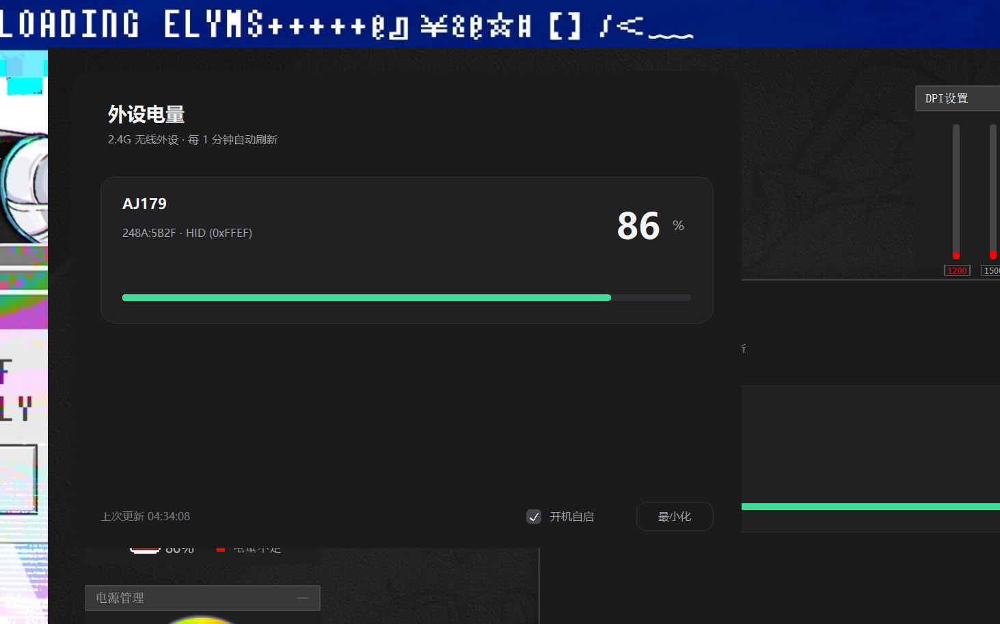

# 2.4G 外设电量（AJ179 增强分支）

在 Windows 10/11 托盘里常驻显示 2.4G 无线鼠标 / 键盘 / 耳机的电量，**纯 Python 标准库实现（`ctypes` + `tkinter`），零第三方依赖，不写日志**。

本仓库 fork 自 [Ap0LoG1zE/EZ2.4G](https://github.com/Ap0LoG1zE/EZ2.4G)，在此基础上增加了 **黑爵 AJAZZ AJ179 无线鼠标**的电量读取支持，并调整了托盘图标的可读性与窗口交互。


托盘里每台设备一个电量圆环：


## 这个分支改了什么

| 改动 | 说明 |
|---|---|
| **AJAZZ AJ179 电量支持** | 新增 `248A:5B2F`（Yichip 方案 2.4G 接收器）专用读取：通过 `Feature Report 0x0C` 拿电量与充电状态。原版只支持「标准 HID 电量」和「抓包学到的输出/输入报告协议」，读不到这只鼠标。 |
| **托盘圆环加粗** | 外径 14 → 15.5、内径不变（10），线宽因此 4 → 5.5：中间留白和原版一样大，环向外扩一圈，托盘里更容易看出大致电量。 |
| **充电变色** | 充电中弧线显示为蓝色 `#3B82F6`；放电时沿用原版配色：≥60% 绿、30–59% 橙、<30% 红。 |
| **右键切换窗口** | 面板打开时再次右击托盘图标会收起面板，未打开时右击则打开，不用再找关闭按钮。 |
| **识别新设备开关** | 面板底部新增「识别新设备」复选框。取消勾选后不再监听热插拔，插拔 Type-C 耳机、读卡器之类不会再弹「发现新设备」；关闭期间仍会静默记录当前设备，重新勾选不会一次性弹一堆。 |

AJ179 的电量卡片（读到的 86% 与官方驱动显示一致）：



圆环对比如下（上排原版外径 14，下排现在外径 15.5；左两列为托盘实际 16px，右列为 32px）：


## 功能一览

**托盘与显示**

- 常驻系统托盘，每台设备一个电量圆环图标，鼠标悬停显示「设备名 + 电量 + 更新时间」
- 左键点击图标立即刷新一次，右键打开 / 收起面板
- 圆环按电量分色：绿（≥60%）、橙（30–59%）、红（<30%）、蓝（充电中）
- 托盘图标 4 倍超采样后缩小绘制，边缘平滑不锯齿

**设备管理**

- 启动时不自动添加设备，未添加时提示「请插入设备 / 或者拔插一下你想要添加的设备」
- 新设备插入或重新拔插时弹窗确认，显示设备名、VID:PID 和当前电量
- 面板底部「识别新设备」开关可关掉上面的热插拔提示，适合经常插拔耳机、读卡器的情况
- 双击卡片上的设备名可直接重命名，名称保存在配置里
- 右键设备卡片可删除设备，同时清除它的协议和上次电量
- 设备休眠或未开机时，显示上次电量 +「上次更新 HH:MM · 设备休眠」，不会把「读不到」当成「没电」

**读取与协议**

- 只读查询，不修改设备任何设置
- 两条协议来源：**标准 HID 电量字段**，或**抓包学习到的请求帧 + 电量字节偏移**
- 抓包助手内置：分析时排除描述符、EP0 标准 setup、字符串描述符与全零报告，保留 HID Feature Report 和厂商自定义报告
- 保存协议前会立即回读校验，不一致就自动丢弃，避免留下坏配置

**其它**

- 深色圆角面板、电量卡片、滚动列表，支持浅色主题跟随
- 自动刷新间隔可调（30–1800 秒），默认 60 秒
- 开机自启（启动项名 `2.4G`），`--install` 一键创建

## 下载与安装

到 [Releases](https://github.com/railgun20001mobai-cmyk/EZ2.4G/releases) 下载：

- **免安装（推荐）**：`2.4G.exe`，双击运行，不需要 Python。
- **最小体积**：`my_devices.py`（约 190 KB），装 Python 3.10+ 后运行。

> exe 未签名，Windows 可能弹 SmartScreen，点「更多信息 → 仍要运行」。

用源码运行：

```bat
python my_devices.py            :: 托盘常驻
python my_devices.py --once     :: 读一次并打印
python my_devices.py --list     :: 列出 HID 接口
python my_devices.py --panel    :: 只开面板，不常驻托盘
python my_devices.py --install  :: 创建开机自启 + 桌面入口
```

也可以直接双击仓库里的 `启动.bat`（自动找 `pythonw`，找不到再退回 `python`）。

## AJ179 电量是怎么读的

这块记录反推过程，方便以后适配同方案的接收器。

- 设备：AJAZZ AJ179 双模鼠标的 2.4G 接收器，`VID:PID = 248A:5B2F`（厂商字符串 `SSCYPL`，Yichip 方案）
- 该接收器的厂商接口 `MI_02`（UsagePage `0xFFEF`，Report ID `0x05`，64 字节）对输出报告只是**原样回显**，不承载电量
- 电量走的是配置接口 `MI_01/col04` 的 **Feature Report `0x0C`**（33 字节）：

```text
请求：0C 01 20 00 <seq> 00  + 27 × 00
回复：0C 01 20 00 <seq> 01 10 00 4D 31 38 34 33 01 00 95 16 FF <电量> <充电> ...
                                    ↑ 产品码 M1843        ↑ 传感器 0x95  ↑ [18]   ↑ [19]
```

- 回复第 **18** 字节是电量百分比，第 **19** 字节是充电标志（`01` = 插线充电）
- 实测校验：充电前读到 `0x51` = 81%，与官方驱动显示一致；插上充电线后变成 `0x64` = 100%，第 19 字节同时变为 `01`

这也是为什么原版「抓包」流程对这只鼠标无效——抓包协议模型只能「写输出报告 + 读输入报告」，读不了 Feature Report。本分支在 `read_saved_device()` 里对 `248A:5B2F` 增加了一条专用分支，其余设备仍走原逻辑。

## 支持设备

| 设备 | 读取方式 | 状态 |
|---|---|---|
| AJAZZ AJ179（`248A:5B2F`） | Feature 0x0C（内置） | 已在真机验证 |
| 任意标准 HID 电量设备 | 标准 HID Usage `0x06/0x20`、`0x0D/0x3B` 等 | 通用 |
| 其它 2.4G 外设 | 抓包学习请求帧 + 偏移 | 取决于协议是否加密 |

原版定位是「不内置设备协议表」，本分支只额外加了 AJ179 这一条硬编码分支，其它设备行为与原版一致。

## 配置文件

路径：`%APPDATA%\BatteryTray\config.json`

| 字段 | 内容 |
|---|---|
| `devices` | 已添加的设备（`vid`、`pid`、`name`） |
| `names` | 自定义显示名，按 `x{VID}{PID}` 索引 |
| `protocols` | 每台设备的协议：`{"kind": "standard"}`、`{"kind": "captured", "requests": [...], "offset": N}`，AJ179 为 `{"kind": "feature"}` |
| `last` | 每台设备上次成功读到的电量、时间与来源 |
| `interval` | 刷新间隔（秒） |
| `watch_new` | 是否监听新插入的设备（`true` / `false`），对应面板底部的「识别新设备」开关 |
| `usbpcap` | `USBPcapCMD.exe` 路径，抓包时使用 |

## 未知设备抓包

前提：安装 [USBPcap](https://desowin.org/usbpcap/) 并重启，抓包需要管理员权限。

1. 插拔一次要抓包的设备，在弹窗里点「添加」
2. **关闭厂家驱动**，点「开始抓包」并允许管理员权限
3. 打开厂家驱动，让它显示一次电量，记下数值
4. 点「停止」，填入刚才的电量
5. 只有一个字节符合：直接保存请求帧和电量字节位置
6. 多个字节符合：换一个相差 10% 以上的电量再抓一次，比对差值

抓包在后台以 `USBPcapCMD -d \\.\USBPcapN -A -o xxx.pcap` 非交互方式运行，不依赖它的控制台界面。

## 从源码构建 exe

```bat
pip install pyinstaller
python -m PyInstaller --noconfirm --clean --onefile --windowed ^
    --name 2.4G --icon app.ico my_devices.py
```

产物在 `dist\2.4G.exe`。

## 环境

- Windows 10/11 x64
- Python 3.10+（含 tkinter）
- 抓包需要 USBPcap + 管理员权限

## 已知限制

- 电量由设备上报，部分设备是 5% 步进
- 加密或需要私有握手的协议无法通过抓包读取
- 仅支持 Windows 10/11 x64
- AJ179 专用分支目前只覆盖 `248A:5B2F`，同方案其它 PID 需要自行补 `AJ179_FEATURE_IDS`
- 设备休眠时读取可能失败，此时显示上次电量

## 致谢与来源

- 原项目：[Ap0LoG1zE/EZ2.4G](https://github.com/Ap0LoG1zE/EZ2.4G)，托盘、抓包助手、协议校验等核心实现均来自原作者
- 原项目未声明开源许可证，本分支仅为个人使用中的修改分享，版权归原作者；如需二次分发请先与原作者确认

## 仓库文件

- `my_devices.py`：主程序（托盘 + 面板 + 抓包助手 + AJ179 协议分支）
- `app.ico`：图标
- `启动.bat`：启动脚本（自动探测 `pythonw` / `python`）
- `docs/panel.png`、`docs/tray.png`：原版界面截图
- `docs/panel-aj179.png`：AJ179 电量卡片实拍
- `docs/icon-preview.png`：圆环粗细对比
